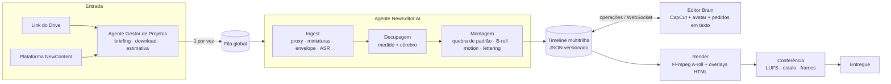

# Revisão de arquitetura — NewEditor.AI

**Data:** 2026-10-09 · **Base:** canvas `NewEditor.AI.canvas` (Obsidian) × código em `Co-Editor/`
**Decisões derivadas:** [ADR-001](adr/ADR-001-timeline-multitrilha.md) · [ADR-002](adr/ADR-002-motor-de-preview-e-render.md) · [ADR-003](adr/ADR-003-cerebro-local-first.md) · [ADR-004](adr/ADR-004-gestor-de-projetos-e-fila.md)

---

## 1. O que o canvas pede

| # | Requisito | Origem no canvas |
|---|---|---|
| R1 | Kanban com 5 fases (Fila → Editando → Editado → Alteração → Entregue); editor sobe projetos por **link do Drive** ou da plataforma | "Kanban com os projetos" |
| R2 | **Gestor de Projetos**: lê a tarefa, cria briefing, baixa o vídeo, manda **um conteúdo por vez** ao NewEditor.AI | idem |
| R3 | NewEditor.AI **estima o tempo** com base nas decisões que vai tomar; o Gestor registra isso na tarefa | idem |
| R4 | NewEditor.AI entrega até **Editado**; humano aprova ou pede alteração | idem |
| R5 | **Editor Brain**: ambiente visual estilo **CapCut**, alterações **por texto**, vistas **em tempo real** | "Software de Edição", "Espaço visual", imagem de referência |
| R6 | **Decupagem refinada ao máximo** — o problema difícil: clientes erram muitas vezes | "Parte Difícil" |
| R7 | Edição como processo: **quebra de padrão**, nunca o mesmo B-roll ou motion **mais de 2×** | "Parte Fácil" |
| R8 | **Avatar** estilo Habbo, moletom azul NewContent: tesoura cortando, pincel no motion, sentado pensando, pulo ao concluir etapa | "diferencial de Branding" |
| R9 | Validar fora da plataforma, local → GitHub → merge na NewContent | conversa |
| R10 | **Sem API paga** durante o desenvolvimento, de preferência nunca | conversa |

## 2. O que existe hoje

```
apps/web (Vite+React)  ◄─ WebSocket ─►  apps/server (Fastify)  ─► FFmpeg · mlx-whisper (uv)
     Editor Brain                         store em memória + JSON em data/projects
                                          decupagem: analyze (medido) + local (regras) | Claude (desligado)
packages/core: Timeline = { main: Clip[] (magnética), removals: Removal[] } + 9 operações puras
```

| Requisito | Estado | Nota |
|---|---|---|
| R1 Kanban | 🟡 Parcial | Colunas na Home, só leitura. Sem arrastar card, sem link do Drive |
| R2 Gestor de Projetos | 🔴 Ausente | — |
| R3 Estimativa de tempo | 🔴 Ausente | — |
| R4 Fluxo até Editado | 🟢 Ok | Status muda sozinho: editando → editado |
| R5 Editor Brain | 🟡 Parcial | Funciona, mas **não é CapCut**: ver §3 |
| R6 Decupagem | 🟡 Boa, não perfeita | 95,6% das palavras iguais ao corte aprovado do Davi; perde repetição colada que o ASR funde |
| R7 Quebra de padrão | 🔴 Ausente | O modelo de dados **não comporta** B-roll/motion (só uma trilha) |
| R8 Avatar | 🟢 Ok | 6 estados. Motion sem uso porque motion não existe ainda |
| R9 Portabilidade | 🟡 | Monorepo limpo; persistência e fila são locais (ok para validar) |
| R10 Sem API | 🟢 Ok | Cérebro local por padrão |

## 3. O que não está funcional do jeito certo (achados)

### Bloqueadores de arquitetura — impedem chegar no "perfeito"

**A1. Timeline de uma trilha só.** `Timeline.main` é uma lista magnética de cortes do A-roll. Não existe
onde colocar B-roll, lettering, motion, trilha ou SFX — e a regra "não repetir B-roll/motion mais de 2×"
(R7) não tem sobre o que operar. Tudo que vem depois da decupagem depende disso. → **ADR-001**

**A2. Preview e render são dois motores diferentes.** O preview troca dois `<video>`; o export é um
filtergraph do FFmpeg. Hoje bate (só tem corte e zoom), mas no primeiro lettering ou motion o que o editor
vê deixa de ser o que o cliente recebe. → **ADR-002**

**A3. Preview corta "sujo".** A troca de clipe é detectada por `requestAnimationFrame` (~16–40 ms de atraso):
em ritmo vertical (corte a cada ~1,5 s) dá para ouvir o pedaço que foi cortado. Editor de verdade agenda
o áudio com precisão de amostra (Web Audio) e sincroniza o vídeo nele. → **ADR-002**

**A4. O "cérebro" é só regra.** Regras resolvem reinício, bastidor e pré-roll (95,6%), mas não escolhem
**a melhor tomada** por fluidez/energia nem entendem roteiro. A preferência é sem API → caminho é
**LLM local** no M5 Pro, com a mesma interface. → **ADR-003**

**A5. Não existe orquestração entre agentes.** A fila é por projeto; o canvas pede o Gestor mandando
**um conteúdo por vez** e registrando estimativa. → **ADR-004**

### Defeitos funcionais — dá para corrigir sem decisão de arquitetura

| # | Defeito | Impacto | Correção |
|---|---|---|---|
| F1 | **Layout não é CapCut**: timeline espremida na coluna do meio (~380 px), avatar ocupa 124 px de altura | Edição desconfortável, foge da referência | Timeline na largura total; mídia/transcrição à esquerda, player no centro, propriedades + agente à direita; avatar sobre a régua |
| F2 | Clipe sem **miniaturas** (filmstrip) e sem trilha de áudio separada | Não dá para "ver" o vídeo na timeline | Gerar sprite de miniaturas no ingest; trilha de áudio abaixo do vídeo |
| F3 | **Re-decupar apaga ajustes manuais** sem avisar | Perda de trabalho | Confirmar; decupagem vira "proposta" aplicada por cima, preservando edições humanas |
| F4 | **Desfazer a decupagem = 37 desfazer** (um por corte) e o histórico some ao reiniciar o servidor | Desfazer inútil em operação grande | Transação: lote de operações = 1 passo de desfazer; histórico persistido |
| F5 | Operação do humano não confere `baseVersion` | Corte por tempo calculado numa versão velha cai no lugar errado se o agente mexeu no meio | Rejeitar/rebasear op baseada em tempo quando a versão mudou |
| F6 | Sem aparar clipe arrastando a borda, sem snap, sem seleção múltipla | Edição manual pobre | Alças de trim com snap em palavra |
| F7 | Edição pela transcrição é só "clicar para restaurar" | O canvas pede edição **por texto** | Selecionar palavras na transcrição → apagar = cortar (estilo Descript) |
| F8 | Gagueira colada ("ningu… ninguém") passa | Sobra erro no corte | Contagem de sílabas por energia × sílabas do texto (ADR-003 §Decupagem) |
| F9 | Export sem **normalização de volume** e sem **conferência pós-render** | Volume errado/estalo chegam ao cliente | −14 LUFS / −1 dBTP; checagem de duração, estalo em cada emenda, imagem de conferência por corte |
| F10 | Pedidos em texto locais cobrem ~8 frases | "Alteração por texto" limitada | Gramática maior agora; LLM local depois (ADR-003) |

## 4. Arquitetura-alvo



Princípios que já valem e continuam:
1. **A timeline é um documento**; agente e humano editam pelas mesmas operações.
2. **Nada se perde**: todo corte é reversível e tem motivo.
3. **Medir antes de afirmar**: bordas pela forma de onda, conferência pelo frame resultante.
4. **Local-first**: nenhum passo exige API paga.

## 5. Andamento

**Fase 1 concluída (2026-10-09):** F1 layout CapCut · F2 miniaturas + trilha de áudio separada · F3 refazer a
decupagem preserva ajustes humanos (pins, cortes, zooms; overlays presos à fala) · F4 desfazer/refazer por
passo (decupagem inteira = 1 passo), histórico salvo em disco · F5 checagem de versão em operação por tempo ·
F6 trim com ímã em palavra · F7 apagar/restaurar pela transcrição · A3 corte preciso no preview (Web Audio) ·
A1 timeline multitrilha + regra dos 2× · F9 (parcial) export com B-roll, SFX/trilha e −14 LUFS.
Benchmark Davi depois da fase: **95,8% das palavras**, IoU 88,3%.

## 6. Roteiro proposto

| Fase | Entrega | Depende de |
|---|---|---|
| **1. Editor Brain de verdade** | F1 layout CapCut · F2 miniaturas + trilha de áudio · F3/F4 transações e desfazer · F6 trim · F7 editar pela transcrição · A3 áudio preciso | — |
| **2. Timeline multitrilha** | ADR-001: trilhas V2 B-roll, V3 lettering/motion, A2 SFX, A3 trilha · operações novas · export FCPXML para o DaVinci | 1 |
| **3. Decupagem perfeita** | F8 sílabas · melhor tomada · benchmark com 5+ brutos reais de clientes | — |
| **4. Montagem** | Quebra de padrão (regra 2×), cut zoom, B-roll, lettering; motion como HTML com `seek(t)` (ADR-002) | 2 |
| **5. Gestor + Kanban** | ADR-004: Kanban arrastável, link do Drive, briefing, estimativa de tempo, fila global | — |
| **6. Export perfeito** | F9 loudness + conferência pós-render | 2 |
| **7. Merge na NewContent** | Trocar JSON/memória por Postgres + storage + fila (interfaces já isoladas) | todas |
